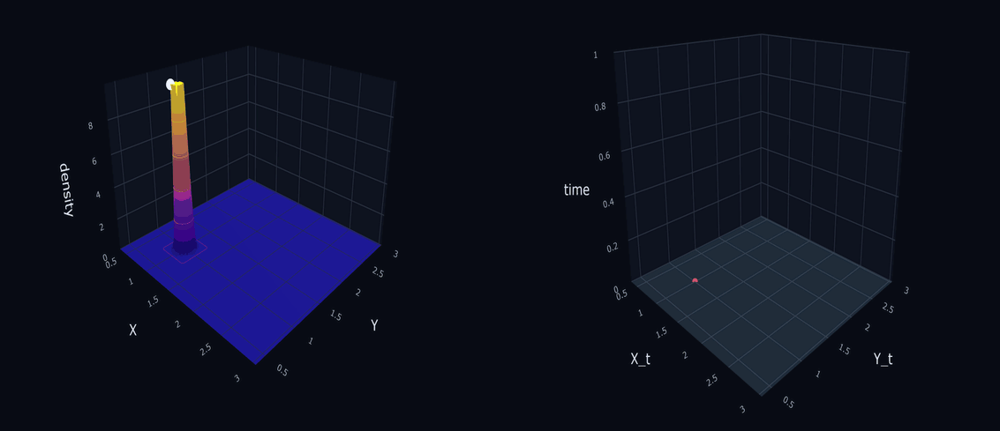
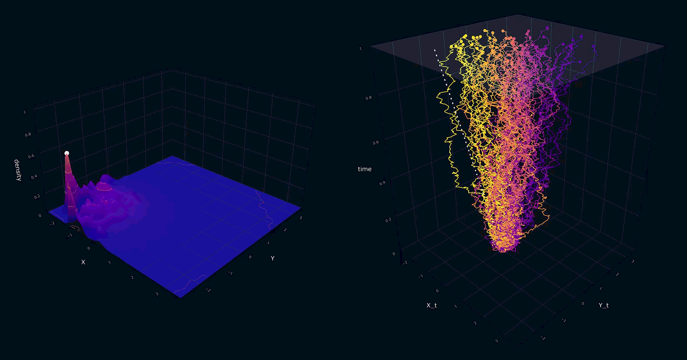
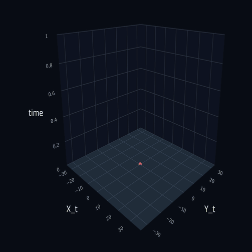
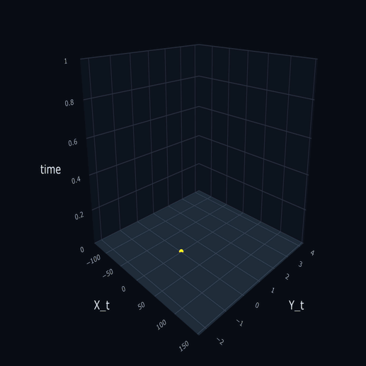
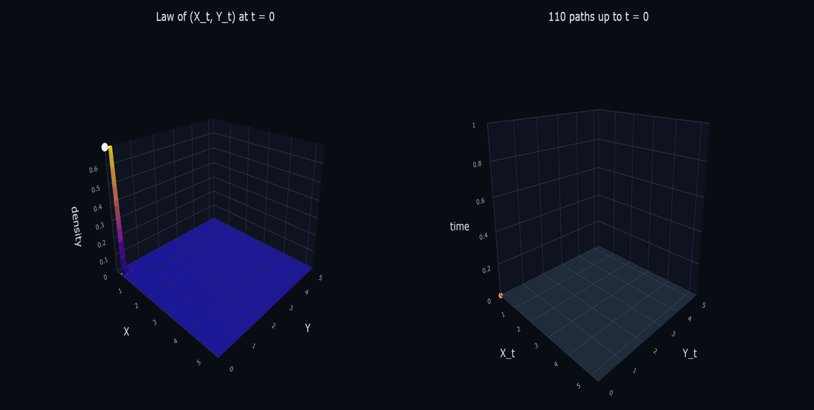

> # radonika_theory-dev

This is the companion notes to the python library [radonika](https://github.com/kalaapks/radonika) that I wrote while building the library. This has detailed discussions on all the codes and design choices I made along with the prerequisite Mathematics needed to understand the codes. 

There is a hyper-linked content below but before that I have added a few plots that can be done with 2 lines of code using this library.

<p align="center">
  
  <br>
  <b>Stock prices will show a drift under standard measure</b>
</p>

<p align="center">
  
  <br>
  <b>In Financial modelling, Esscher's tilt is used to remove drift by reweighting the individual paths based on the abstract theory of Radon-Nikodym derivative</b>
</p>

<table align="center" cellspacing="10">
  <tr>
    <td align="center">
      <br>
      <b>Cauchy jump process with mean (0, 0) and scale (1, 1)</b>
    </td>
    <td align="center">
      <br>
      <b>Cauchy jump process with mean (0.9, 1.3) with scale (4, 1)</b>
    </td>
  </tr>
</table>

<p align="center">
  
  <br>
  <b>2D Poisson jump process showing how the piecewise structure of pdf evolves over time</b>
</p>

Visit [radonika](https://github.com/kalaapks/radonika) to see how to code these. The particular codes for these 4 plots are given in the end of this file.

---


# NOTES & INDEX

These notes were primarly built to keep track of the functions in this library but they are also a guide on how to use the python libraries `stochastics` or `aleatory`, in particular the codes on how to plot the empirical density functions evolving over time. We discuss how to plot Stochastic paths and then how to use `stochastics` on them. We also discuss how to read and draw conclusions from the output, once the plots are done. We will also see how to use `Plotly` after that. Once we get the basic understanding of what are the tools we already have, or more importantly, what we do not have, ONLY THEN we build the lacking visual aids and turn them into this library. 


Since there are a lot of `Plotly` plots involved, it is recommended that we access the files through the following **Contents** instead of the above `ipynb` files. The above files will lead to bunch of codes with no rendered outputs since GitHub’s built-in notebook viewer doesn’t run JavaScript from notebook outputs, and Plotly’s interactivity (hover, zoom, sliders) depends on JavaScript.

## CONTENTS

1. 2-Dimensional Stochastic Processes

   1.1. [Standard 1D Processes reacp](https://kalaapks.github.io/radonika_theory-dev/01_2D_Stochastic_processes/2D_Stochatsic_paths.html)

   1.2. [Mathematical Prerequisites](https://kalaapks.github.io/radonika_theory-dev/01_2D_Stochastic_processes/Math_prerequisites.html)
   
   1.3. [Introduction to Python library `Plotly`](https://kalaapks.github.io/radonika_theory-dev/01_2D_Stochastic_processes/Introduction_to_Plotly.html)

3. Developing the `radonika` library

   2.1. [Process Layer](https://kalaapks.github.io/radonika_theory-dev/02_radonika/Radonika_process_layer.html)

   <!-- 2.2. [Measure Layer](https://kalaapks.github.io/radonika_theory-dev/02_radonika/Radonika_measure_layer.html) -->

---

## CODES

These are the codes for creating the above plots. Once you visit [radonika](https://github.com/kalaapks/radonika) and are done with the pip-install steps the following lines of code will make the plots I attached in the beginning.

```python
import radonika as rd
m = rd.stocks(mu=0.45, sigma=0.4, r=0.03, seed=1) 
m.plot_law(start=None, time=None, time_slice=35, n=60, seed=1)
```
We get a vertical time slider, as you move it up the process it self proceeds in the temporal direction. You will also get other toggles such as $\mathbb{P}$, $\mathbb{Q}$, $\mathbb{Q}_1$ and $\mathbb{Q}_2$ that lets us move among other measures. `stocks` start at $(1, 1)$ by default. If you want to see `time_slices`, keep `time=None`. If `time=s` is taken, we get the process on $[0, s]$ directly.

```python
import radonika as rd
m = rd.bm(mu=0.5, sigma=1.0, seed=1) 
m.tilt(time_slice=12, n=70, theta_range=(-2, 2), seed=1)
```
`m.tilt()` calls the *Esscher's tilt*. We see the θ slider appear and this lets us control the drift change as the `theta` changes. 

Note that we will only have one slider θ. For now, the drift can only move along $(1, 1)$ direction (basically (θ, θ) instead of (θx, θy)) was a design choice I made. May be someday I will improve this, the underlying math supports (θx, θy) already.

```python
import radonika as rd

m = rd.cauchy_process(scale=1.0, loc=0.0, seed=1)
m.plot_law(start=None, time=None, time_slice=35, n=60, seed=1)

M = rd.cauchy_process(scale=[4.0, 0.1], loc=[0.9, 1.3], seed=666)
M.plot_law(start=None, time=None, time_slice=35, n=350, seed=666)
```
This will create both the Cauchy jump processes. As you can see the library is suited to take in both scalar and vector entries. For scalars, the parameter `alpha` is simply duplicated to become `(alpha, alpha)`.

```python
import radonika as rd
m = rd.poisson(rate=2.0, seed=1)
m.plot_law(start=None, time=None, time_slice=35, n=60, seed=1)
```
For discrete processes, the density surface is created using the probability mass function naturally.

---
